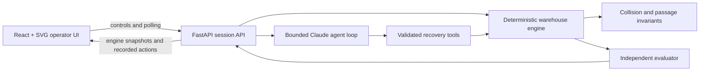

# FleetRescue

**Safety-bounded AI recovery for a shared-passage warehouse fleet.**

FleetRescue is a deterministic warehouse simulation in which three autonomous robots share a narrow passage while transporting payloads. A failed robot can retain a stale passage reservation even when it is physically outside the passage, stopping otherwise healthy traffic.

The recovery agent does not receive direct access to the engine. It investigates through a small tool interface, selects only validated corrective actions, and then observes the warehouse again. A separate evaluator—not the model—decides whether deliveries resumed without violating safety invariants.

## Key capabilities

- Stateful robot positions, routes, payloads, deliveries, reservations, and event history.
- Collision prevention and exclusive shared-passage occupancy enforced on every tick.
- Recoverable, unsafe occupied-passage, and healthy-control scenarios.
- Bounded Anthropic tool-calling loop with token, request, tool-call, timeout, retry, and cost limits.
- Safety-validated reservation release and robot quarantine tools.
- Independent post-action evaluation based on physical progress and safety state.
- React digital twin driven only by FastAPI snapshots from the Python engine.
- Explicit scene transitions for fault injection and reset, without fabricated movement.
- Offline unit, safety, request-contract, evaluator, and API integration tests.

## Technology

- **Frontend:** React, TypeScript, Vite, SVG
- **Backend:** FastAPI, Uvicorn, Python
- **Agent:** Anthropic Claude tool calling
- **Testing:** pytest and FastAPI TestClient

## Architecture



The Python engine is the single source of truth. The frontend cannot move robots, clear reservations, or manufacture recovery results. The model cannot execute commands, read files, or directly mutate simulation state.

## Windows setup

Requirements:

- Python 3.11 or newer
- Node.js 20 or newer
- PowerShell

From the repository root:

```powershell
py -3.13 -m venv .venv
.\.venv\Scripts\python.exe -m pip install --upgrade pip
.\.venv\Scripts\python.exe -m pip install -r requirements.txt

Set-Location frontend
npm.cmd ci
Set-Location ..
```

If Python 3.13 is not installed, replace `py -3.13` with an available Python 3.11+ launcher.

## Environment configuration

Create a local configuration file from the safe placeholder example:

```powershell
Copy-Item .env.example .env
```

Set these values locally:

- `ANTHROPIC_API_KEY`: your Anthropic credential.
- `FLEETRESCUE_MODEL`: the exact model ID permitted for the live run.

Never commit the local `.env`. Offline simulation and test execution do not require a paid API call.

## Run locally

From the repository root, start FastAPI in the first PowerShell window:

```powershell
.\.venv\Scripts\python.exe -m uvicorn app:app --host 127.0.0.1 --port 8123
```

From the repository root, start Vite in a second PowerShell window:

```powershell
Set-Location frontend
npm.cmd run dev
```

Open `http://127.0.0.1:5173`. Vite proxies `/api` to FastAPI at `127.0.0.1:8123`.

For a production-style local build:

```powershell
Set-Location frontend
npm.cmd run build
Set-Location ..
.\.venv\Scripts\python.exe -m uvicorn app:app --host 127.0.0.1 --port 8123
```

Then open `http://127.0.0.1:8123`.

## Offline validation

The following commands make no Anthropic API calls:

```powershell
.\.venv\Scripts\python.exe -m pytest -q

Set-Location frontend
npm.cmd run build
```

The four UI controls are backed by tested API operations:

- **Start Simulation** advances the real engine.
- **Inject Fault** loads the recoverable incident as an explicit scene transition.
- **Run Recovery Agent** starts the configured bounded agent only after a fault exists.
- **Reset** restores a clean deterministic scenario.

The guarded smoke-test plan can be inspected offline with:

```powershell
.\.venv\Scripts\python.exe dev_smoke.py
```

Do not use its paid execution flag without explicit authorization and valid local configuration.

## Evaluation evidence

### Offline coverage

The test suite covers normal delivery progress, collision and passage invariants, unsafe occupied-passage escalation, preservation of healthy reservations, bounded agent behavior, sanitized provider failures, Anthropic request structure, API synchronization, rapid control transitions, and mocked recovery traces.

### Live Claude result

One authorized paid DEV smoke test used the real `claude-sonnet-5-5` tool-calling agent on the corrected recoverable scenario. This is a record of **one successful live recovery test**, not a benchmark or general success rate.

- Independent outcome: **COMPLETE**
- New deliveries during independent verification: **3**
- Safety violations: **0**
- Both healthy robots resumed operations.

The agent investigated robot state, physical passage occupancy, and reservation ownership before releasing the stale reservation. Independent verification then advanced the engine and measured delivery recovery. The failed robot remained outside the passage and was not moved by the repair.

## Safety model

- A reservation cannot be released unless the passage is physically empty and the owner satisfies inactivity checks.
- An inactive robot occupying the passage is treated as unsafe and requires escalation.
- Retries and correction attempts share the same run limits.
- The guarded runner stops issuing requests after its timeout or before a request could exceed the configured budget.
- Model prose is never accepted as proof of recovery; only evaluator-observed engine state determines the outcome.

## Current limitations

- Three-robot deterministic simulation.
- Fixed delivery tasks and shortest-path routes.
- In-memory state that resets when the FastAPI process restarts.
- No authentication, persistence, deployment layer, or multi-tenant operation.
- No physical robotics, sensor, PLC, or warehouse-management-system integration.
- Simulated physical occupancy is exact ground truth rather than a real sensor-confidence estimate.

## Future improvements

- Persist incident and evaluation history.
- Add configurable layouts and larger fleet workloads.
- Introduce sensor uncertainty and delayed telemetry in a separate evaluation mode.
- Integrate with a robotics simulator before considering real warehouse hardware.
